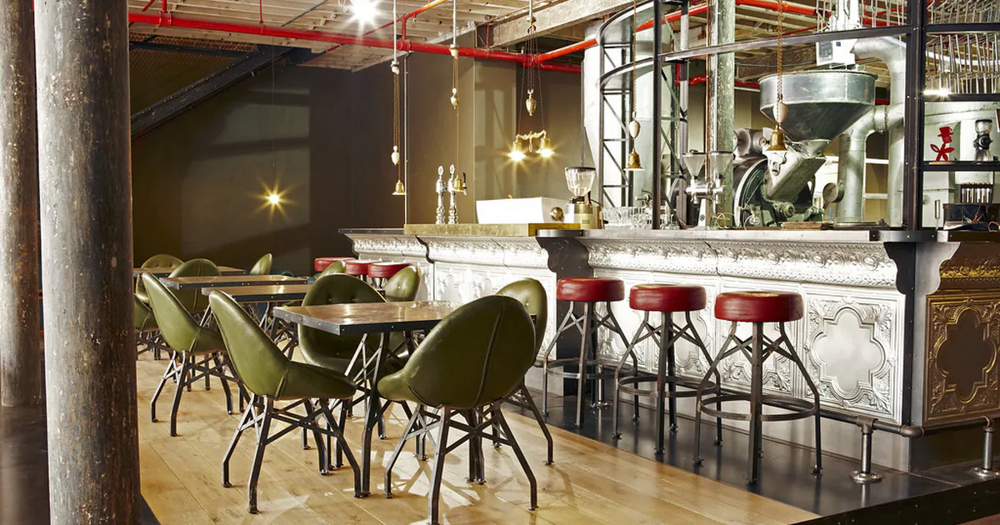
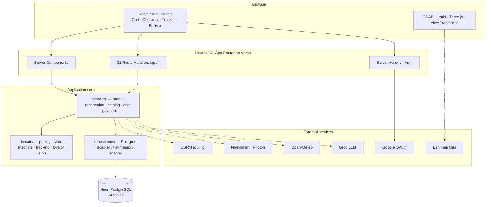
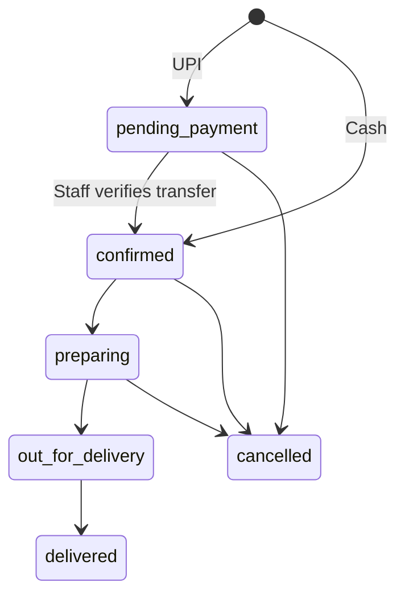

<div align="center">



<br />
<br />


# AURA TOAST

### Atmospheric Craft · Pure Origin

**A full-stack specialty-coffee platform.** Order from twelve cafés in six cities, follow your cup to the door on a live map,<br />
reserve a table, earn loyalty points, subscribe to whole beans and talk to an AI barista that can actually fill your cart.

<br />

[](https://aura-roast-cafe.vercel.app)

<br />


<br />

[Highlights](#highlights) · [Features](#features) · [Experience](#the-experience) · [Architecture](#architecture) · [Correctness](#correctness-guarantees) · [Data](#database) · [API](#api-reference) · [Security](#security--privacy) · [Run it](#getting-started) · [Deploy](#deployment)

</div>

<br />

## Highlights

<table>
<tr>
<td width="33%" valign="top">

### ☕ Commerce done right
Server-owned pricing in integer paise, idempotent order placement, atomic seat booking, an order state machine, and UPI payments with zero card data anywhere in the system.

</td>
<td width="33%" valign="top">

### 🗺️ Live delivery tracking
Address and PIN code are geocoded at checkout, routed once on real roads with OSRM, then the courier's position, stage and ETA are derived from elapsed time — no cron, no worker, no Redis.

</td>
<td width="33%" valign="top">

### ✨ A cinematic interface
A 144-frame scroll-scrubbed hero, a Three.js bean field that roasts from green to dark as you scroll, View Transitions between routes, GSAP page openings and a footer that signs off letter by letter.

</td>
</tr>
</table>

<br />

## Features

| Area | What it does |
|---|---|
| **Menu & Brew Builder** | 16 drinks from five named farms. Size, milk, shots, syrup and temperature with live price and caffeine; every quote is confirmed by the server. |
| **Pairings** | Twelve plates, each tasted against specific drinks. Adding a coffee to the cart suggests the plates made for it; drink pages lead with their best matches. |
| **Cart & Checkout** | Persistent cart, promo codes, tips, GST. A six-digit **PIN code** names the area back to the guest ("Delivering to Bandra West, Mumbai") and picks the nearest café. Cash or UPI. |
| **Live Tracking** | Leaflet map with a live badge, the courier moving along the real road route, ETA and expected arrival time, stage timeline, and cancellation until the order leaves the bar. |
| **UPI Payments** | UPI deep link and QR generated locally, UTR capture from the guest, one-click verification by staff. |
| **Reservations** | 30-minute table slots across every café plus weekly cuppings and brew classes, booked through one atomic capacity check. |
| **Accounts & Loyalty** | Google sign-in. Four Halo tiers derived from lifetime points, with an append-only ledger; points are reversed if an order is cancelled. |
| **Subscriptions** | Whole beans weekly, fortnightly or monthly — skip, pause, resume or cancel. |
| **AI Barista** | Groq (`openai/gpt-oss-120b`) with real tool calls into the same services the API uses: search the menu, add to cart, look up an order, check tables. Falls back to a local responder if the model is unavailable. |
| **Origins & Places** | A map of the five farms with terrain relief that flies to each story as you scroll; a store locator with live open/closed status in IST and directions to every café. |
| **Back Office** | Staff dashboard with every order, live stages, pending UPI transfers and reservations, gated by `ADMIN_EMAILS`. |

### What needs an account

Browsing is open to everyone. **Placing an order, booking a table and writing a review require signing in** — the page sends the guest to sign in and straight back (the cart is kept), and the API refuses the request without a session.

| Open to all | Requires sign-in |
|---|---|
| Menu, drink pages, pairings, origins, guides, locations, stores | Checkout and placing an order |
| Building drinks and filling the cart | Booking a table or event |
| Table availability, the AI Barista | Writing a review |
| Tracking an order from its link | Subscriptions, loyalty, order history |

<br />

## The Experience

| Moment | How it is built |
|---|---|
| **Hero** | 144 desktop / 72 mobile frames decoded off the main thread with `createImageBitmap`, a bounded window of 32 frames in memory, painted straight to canvas. |
| **Green to roast** | A Three.js `InstancedMesh` of ~190 procedurally modelled beans. One scrubbed ScrollTrigger drives their colour, gloss and size, the drum temperature, the roast stage and a progress track. Sparks appear at first crack. |
| **Page openings** | Every inner page's header unmasks with GSAP; a persistent bean field behind the top of each page *re-roasts* to that page's colour on navigation instead of reloading. |
| **Sign-in** | Split layout over a drifting 3D bean field, a glass card with an orbiting light, Sign in / Create account tabs, and a line that says why the guest was sent there. |
| **Route changes** | View Transitions with a variant per route family, a progress hairline on every navigation, and a CSS fallback where the API is missing. |
| **Micro-interactions** | Images that develop from a shimmer, a cart that bumps with a floating "+1", staggered drawer lines, a cursor spotlight on cards, springing chips and steppers. |
| **Footer** | A call to action, a live "bars brewing now" status, the full index and the brand wordmark rising letter by letter, then a single sweep of light. |

**Performance rules.** Three.js loads only when a 3D section is about to be seen (never in the initial bundle), renders in a single draw call, caps the pixel ratio, halves the bean count on phones, and stops rendering when off screen or in a background tab. Everything honours `prefers-reduced-motion`.

<br />

## Architecture



| Layer | Path | Responsibility |
|---|---|---|
| **Routes & pages** | `src/app/` | Validate input, resolve the viewer, call a service, serialise the response. |
| **Services** | `src/services/` | Business workflows: placing and cancelling orders, bookings, payments, the Barista. |
| **Domain** | `src/domain/` | Pure functions — pricing, state machines, tracking, loyalty, slots. Shared by server and client. |
| **Repositories** | `src/repositories/` | One API over two adapters: Postgres (Neon over HTTP, or `pg`) and an in-memory store for zero-config development. |
| **Lib** | `src/lib/` | Session, HTTP helpers, ids, geocoding, routing, weather, UPI, opening hours. |
| **UI** | `src/components/` | Client islands, the motion system (`motion/`) and the 3D scenes (`three/`). |

<br />

## Correctness Guarantees

**Server-owned pricing.** The client prices the cart instantly with the same pure function the server uses, but only `drinkId`, quantity and modifier `kind`/`slug` are read from the request — every price is re-read from the catalogue. Money is integer paise end to end, and a CHECK constraint enforces `total = subtotal + tax + delivery + tip − discount`.

**Idempotent orders.** `POST /api/orders` requires an `Idempotency-Key`. The whole persisted payload is hashed:

| Situation | Result |
|---|---|
| New key | Order placed — `201` |
| Same key, same body, finished | Original order replayed — `200` |
| Same key, different body | `422` conflict |
| Same key, still in flight | `409` |

**Atomic seat booking.** One statement, no read-before-write, backed by `CHECK (booked_count <= capacity)`:

```sql
UPDATE reservation_slots
   SET booked_count = booked_count + $seats
 WHERE id = $slot AND booked_count + $seats <= capacity
RETURNING capacity - booked_count;
```

**Stateless tracking.** At confirmation the address and PIN are geocoded, OSRM is called once and the route and a seeded delivery plan are stored. Every read derives the stage, courier position and ETA from elapsed time.

**Guarded state changes.** Every status write goes through `assertTransition()`; verification and cancellation are conditional updates, so two staff clicks or two tabs can never confirm, charge or reward an order twice.



<br />

## Database

24 tables managed with Drizzle ORM; migrations live in `drizzle/migrations`.

| Domain | Tables |
|---|---|
| Identity | `users`, `accounts`, `sessions`, `verification_tokens`, `addresses` |
| Catalogue | `origins`, `drinks`, `modifiers`, `drink_modifiers`, `stores`, `guides`, `content_blocks` |
| Commerce | `orders` (incl. `delivery_pincode`), `order_items`, `subscriptions`, `loyalty_ledger`, `reviews` |
| Reservations | `reservation_slots`, `reservations` |
| Infrastructure | `idempotency_records`, `rate_limits`, `geocode_cache`, `weather_cache`, `chat_sessions` |

Loyalty tiers are never stored — they are derived from `lifetime_points` on read. Reservation slots are created lazily the first time a day is viewed, so there is no cron to run.

<br />

## API Reference

<details>
<summary><b>31 route handlers — expand</b></summary>

<br />

| Method | Endpoint | Access | Purpose |
|---|---|---|---|
| `GET` | `/api/health` | Public | Backend, latency, feature flags. `?check=groq` verifies the AI key and model. |
| `GET` | `/api/menu` · `/api/menu/search` | Public | Catalogue and weighted search |
| `POST` | `/api/menu/quote` | Public | Server price for a Brew Builder configuration |
| `POST` | `/api/orders/preview` | Public | Server-priced cart totals |
| `POST` | `/api/orders` | **Signed in** · Idempotency-Key · 12/min | Place an order |
| `GET` | `/api/orders/:number` | Owner | Full order |
| `GET` | `/api/orders/:number/track` | Order link | Live tracking (contact details masked) |
| `POST` | `/api/orders/:number/cancel` | Owner | Cancel before it leaves the bar |
| `PATCH` | `/api/orders/:number/utr` | Owner | Attach a UPI reference |
| `PATCH` | `/api/admin/orders/:number/verify-payment` | Staff | Confirm a UPI transfer |
| `GET` | `/api/reservations/availability` | Public | Slots and events |
| `POST` | `/api/reservations` | **Signed in** · 10/min | Book a table or event |
| `GET` · `DELETE` | `/api/reservations/:ref` | Owner or staff | Look up or cancel |
| `GET` · `POST` · `PATCH` | `/api/subscriptions` | **Signed in** | Subscription lifecycle |
| `GET` | `/api/loyalty/:userId` | Account owner | Tier, points, ledger |
| `GET` · `POST` | `/api/reviews` | Public read · **signed-in** write | Reviews |
| `POST` | `/api/chat` | Public · 20/min | AI Barista |
| `GET` | `/api/geocode` | Public · 30/min | Geocode, autocomplete, `mode=pincode` |
| `GET` | `/api/weather` · `/api/recommendations` | Public | Weather-aware suggestions |
| `GET` | `/api/stores` · `/api/stores/nearby` · `/api/origins` · `/api/guides` · `/api/content` · `/api/settings/payment` | Public | Content and configuration |
| `GET` · `POST` | `/api/cron/cleanup` | `CRON_SECRET` | Sweep expired keys and rate-limit rows |
| `*` | `/api/auth/*` | Auth.js | Google sign-in |

Errors share one shape: `{ "error": "Readable message", "code": "machine_code" }`.

</details>

<br />

## Security & Privacy

| Control | How |
|---|---|
| **Authentication** | Google only (no passwords stored), verified emails, encrypted JWT sessions. |
| **Authorisation** | Ordering, booking and reviewing require a session; staff routes require `ADMIN_EMAILS` or a bearer secret — an unset secret denies. |
| **Unguessable orders** | Random order numbers (`AT-7K3M9Q`); failed ownership checks return `404`, not `403`. |
| **Data minimisation** | Tracking and confirmation pages never ship the guest's email; phones are masked to the last four digits. Café phone numbers are never sent to the browser. |
| **Tamper-proof pricing** | Prices, discounts and item names come only from the database. |
| **Rate limiting** | Postgres-backed token buckets keyed on a trusted client IP. |
| **Validation** | Zod on every mutation; bounded string lengths. |
| **Headers** | `nosniff`, `SAMEORIGIN` framing, strict referrer policy, locked permissions policy. |
| **Payments** | No card data exists anywhere in the system. |

<br />

## Getting Started

**Requirements:** Node.js 22, npm 10.

```bash
git clone https://github.com/ManasSaxena14/AuraRoast.git
cd AuraRoast
npm install
npm run dev
```

Open http://localhost:3000. With no `.env.local` the app runs end to end on the in-memory adapter, and with no Google credentials you are signed in automatically as a demo account.

**Against a real database and Google sign-in:**

```bash
cp .env.local.example .env.local   # then fill in the values below
npm run db:migrate
npm run db:seed
npm run dev
```

| Script | Does |
|---|---|
| `npm run dev` | Development server |
| `npm run build` · `npm start` | Production build and server |
| `npm run typecheck` | Strict TypeScript check |
| `npm run db:generate` · `db:migrate` · `db:seed` · `db:studio` | Drizzle schema, migrations, seed data, studio |

<br />

## Environment Variables

| Variable | Needed for | Notes |
|---|---|---|
| `NEXT_PUBLIC_SITE_URL` | Production | `https://aura-roast-cafe.vercel.app` — used for social cards; baked in at build time |
| `DATABASE_URL` | Production | Neon **pooled** connection string |
| `DATABASE_URL_UNPOOLED` | Migrations | Neon **direct** connection string |
| `AUTH_SECRET` | Sign-in | `openssl rand -base64 32` |
| `AUTH_GOOGLE_ID` · `AUTH_GOOGLE_SECRET` | Sign-in | Google Cloud OAuth client |
| `ADMIN_EMAILS` | Back office | Comma-separated Google emails allowed into `/admin` |
| `UPI_ID` · `UPI_PAYEE_NAME` | UPI payments | Your real UPI ID — the default is a placeholder |
| `GROQ_API_KEY` | AI Barista | Without it a local responder answers |
| `GROQ_MODEL` | AI Barista | Optional; defaults to `openai/gpt-oss-120b` |
| `ADMIN_SECRET` · `CRON_SECRET` | Optional | Bearer secrets for scripts and the cleanup route |

<br />

## Deployment

Deployed on **Vercel** with **Neon** Postgres — see [DEPLOYMENT.md](DEPLOYMENT.md) for the full checklist.

1. Import the repository in Vercel (Framework: Next.js, Node 22).
2. Add the environment variables above, with `NEXT_PUBLIC_SITE_URL=https://aura-roast-cafe.vercel.app`.
3. In Google Cloud Console → Credentials → your OAuth client, add:
   - Authorized JavaScript origin: `https://aura-roast-cafe.vercel.app`
   - Authorized redirect URI: `https://aura-roast-cafe.vercel.app/api/auth/callback/google`
4. Run pending migrations against the production database (`npm run db:migrate` with `DATABASE_URL_UNPOOLED` set).
5. Verify:
   - [`/api/health`](https://aura-roast-cafe.vercel.app/api/health) → `"backend": "postgres"`
   - [`/api/health?check=groq`](https://aura-roast-cafe.vercel.app/api/health?check=groq) → key accepted, model available

<br />

## Project Structure

```text
src/
├── app/              Pages, 31 API route handlers, server actions
├── auth.ts           Auth.js configuration (Google)
├── components/
│   ├── motion/       GSAP, Lenis, View Transitions, page openings, scroll effects
│   ├── three/        Three.js bean field and its React wrappers
│   ├── auth/         Sign-in card and the sign-in gate hook
│   └── …             Cart, checkout, tracker, map, barista, admin, footer
├── config/           Validated environment, site navigation
├── data/             Catalogue, origins, stores, pairings, guides
├── domain/           Pure business rules
├── lib/              Session, HTTP, geocoding, routing, hours, UPI
├── repositories/     Postgres and in-memory adapters, schema
├── services/         Orders, reservations, catalog, payments, AI Barista
└── styles/           Tokens, components, motion, maps, 3D stages
drizzle/              Migrations and seed script
public/hero/          Hero animation frames (144 desktop, 72 mobile)
```

<br />

## Roadmap

- [ ] Payment gateway (Razorpay) with signed, idempotent webhooks
- [ ] Courier updates over Server-Sent Events
- [ ] Order notifications through an outbox queue
- [ ] Postgres full-text search (`tsvector` + GIN)
- [ ] Automated test suite and CI

<br />

---

<div align="center">


**AURA TOAST** — *Atmospheric Craft, Pure Origin.*

Built by **[Manas Saxena](https://github.com/ManasSaxena14)** · [aura-roast-cafe.vercel.app](https://aura-roast-cafe.vercel.app) · MIT License

</div>
